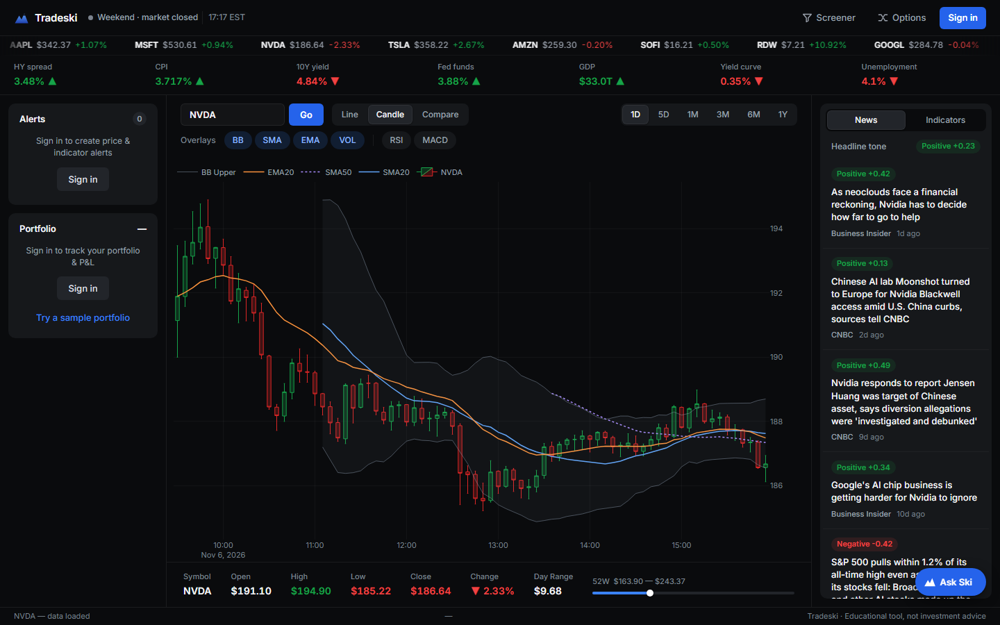
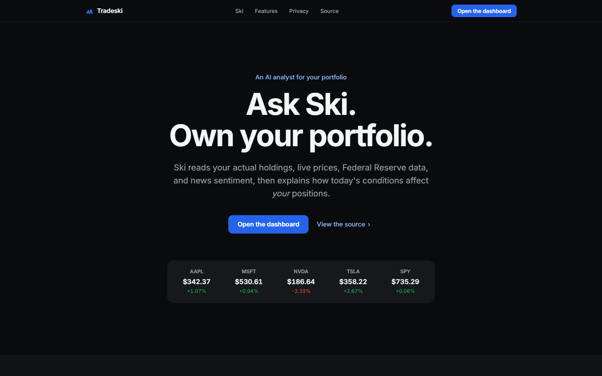

<div align="center">

# Tradeski

**A real-time financial analytics platform for retail investors.**

Live charts · Federal Reserve macro data · AI-powered assistant · Portfolio risk analytics · News sentiment

[](https://github.com/Danny-397/Tradeski/actions/workflows/ci.yml)
[](https://www.python.org/)
[](LICENSE)
[](#running-tests)
[](https://render.com)
[](https://vercel.com)

### [→ tradeski.dev](https://tradeski.dev)

<br>



<sub>Live dashboard: candlesticks with hand-computed Bollinger Bands, SMA/EMA overlays, a Federal Reserve macro ribbon, and RSI / MACD / Z-score readouts — Ski (bottom-right) reads all of it.</sub>

</div>

---

Tradeski integrates six distinct data pipelines — live equity prices, option chains, Federal Reserve macroeconomic data, financial news with sentiment scoring, a fundamental stock screener, and an AI assistant grounded in real-time context — into a single coherent interface, with quantitative portfolio analytics and a 90-day correlation heatmap layered on top.

Every quantitative indicator is hand-written directly on NumPy arrays — no TA-Lib, no pandas — so the indicator logic itself (Wilder smoothing, MACD divergence, band math) is the project's own code, with NumPy supplying only primitive operations like mean, standard deviation, and least-squares. The AI assistant (Ski) receives live macro, portfolio, and news data on every request — not generic training knowledge. The backend is a persistent WebSocket server deployed on Render; the frontend is a static site on Vercel.

| | |
|---|---|
| **Backend** | Python 3.12 · Flask · Flask-SocketIO · gevent |
| **Frontend** | Vanilla JS · Plotly.js · Socket.IO |
| **Data** | yfinance · FRED API · NewsAPI · Anthropic Claude |
| **Tests** | 251 tests across 25 files — CI on every push |
| **Deployment** | Render (backend) · Vercel (frontend) · tradeski.dev |

<div align="center">



<sub>The landing page at tradeski.dev, with a live price strip streamed from the backend.</sub>

</div>

---

## Table of Contents

- [Features](#features)
- [Architecture](#architecture)
- [Tech Stack](#tech-stack)
- [Quantitative Indicators](#quantitative-indicators)
- [Ski — AI Financial Assistant](#ski--ai-financial-assistant)
- [Production Hardening](#production-hardening)
- [API Reference](#api-reference)
- [Getting Started](#getting-started)
- [Running Tests](#running-tests)
- [Deployment](#deployment)
- [Background](#background)

---

## Features

### Real-Time Price Streaming

Live equity prices broadcast over WebSocket (Socket.IO / gevent) with automatic chart extension, a scrolling ticker tape across 11 symbols, and color-coded flash animations on every price update.

### Interactive Charts

| Capability | Detail |
|:---|:---|
| Chart types | Candlestick (OHLC) and line chart |
| Timeframes | 1D (5-min bars) · 5D (15-min) · 1M · 3M · 6M · 1Y (daily) |
| Overlays | Bollinger Bands · SMA 20/50 · EMA 20 — each independently toggleable |
| Subpanels | RSI and MACD as separate panels below the main chart |
| Click-to-inspect | Click any candle to populate the data strip with exact OHLC, change %, and range |
| Compare mode | Normalize up to 5 symbols to a common 0% baseline for relative performance |

### Macroeconomic Ribbon

A live ribbon beneath the header pulls seven Federal Reserve series from the FRED API, refreshed hourly. Each indicator displays its current value, trend direction (↑ / ↓), and date of last observation.

| FRED Series | Metric |
|:---|:---|
| CPIAUCSL | Consumer Price Index (YoY %) |
| FEDFUNDS | Effective Federal Funds Rate |
| GDP | Real GDP (Chained 2017 $B) |
| UNRATE | Unemployment Rate |
| DGS10 | 10-Year Treasury Yield |
| T10Y2Y | Yield Curve Spread (10Y − 2Y) |
| BAMLH0A0HYM2 | High-Yield Credit Spread (OAS) |

### News Feed & Sentiment Analysis

News is the sidebar's first tab, open when the dashboard loads. Recent headlines per symbol are fetched from NewsAPI, matched on the company's name (or the ticker) **in the title**, first from about twenty financial news sites (Reuters, Bloomberg, CNBC, WSJ, MarketWatch...), widening to any source only when those have fewer than four. The name comes from the dashboard's own ticker index, so every listed company gets a real query, not "XYZ stock". Headlines are then scored with VADER sentiment analysis. The standard VADER lexicon is augmented with ~30 financial-domain terms (`"beats" → +2.0`, `"bankruptcy" → −3.0`, `"downgraded" → −1.8`) to correct systematic under-scoring of financial jargon. Each article shows a BULLISH / BEARISH / NEUTRAL chip with its numeric score, and an aggregate sentiment badge summarizes the overall tone.

### Portfolio Tracker & Risk Analytics

Add holdings by symbol, share count, and average cost basis. See unrealized P&L in real time, persisted in SQLite via UPSERT. The risk metrics panel computes three statistics from one year of daily returns weighted by current market value:

| Metric | Method |
|:---|:---|
| Sharpe Ratio | Annualized excess return / annualized volatility · risk-free rate: the current fed funds rate from FRED (4.5% if FRED is unavailable) |
| Portfolio Beta | Covariance with SPY / variance of SPY over 252 trading days |
| Annualized Volatility | Rolling standard deviation of weighted daily returns × √252 |

### Correlation Heatmap

A full-screen modal shows a pairwise 90-day return correlation matrix for all 11 tracked symbols, rendered as a Plotly heatmap with a diverging red-to-green colorscale. Cached server-side for one hour.

### Alert Engine

Rule-based alerts — price above/below a level, RSI overbought (>70) / oversold (<30), volume spike (2× the 20-day average), volatility spike (|z| > 2.5). They are checked against **price history since the alert was created**, not live ticks ([`alert_eval.py`](tracker/alert_eval.py)), so a move that happened while the free-tier backend was asleep still fires, stamped with when it happened. Price alerts use hourly bars, so they are precise to about an hour. A fired alert moves to a Triggered list, shows in the status bar, and raises a browser notification if you allowed them. Delivery is by the owner's own request, never a socket broadcast.

### Stock Screener

Fundamental data for 28 curated stocks across five sectors, fetched in parallel via an 8-worker thread pool and cached per symbol. Filterable by P/E ratio, market cap tier, sector, and 52-week performance. Clicking a result loads that symbol on the chart.

### Options

An **Options** window ([`tracker/options.py`](tracker/options.py), [`frontend/options.js`](frontend/options.js)) for any optionable ticker, in three tabs:

- **Chain.** Calls and puts side by side for any expiry, with bid/ask, volume, open interest, implied volatility and delta. Filters for strike distance from the spot, |delta|, minimum open interest and volume, and maximum bid/ask spread hide the illiquid strikes. Above the chain: the at-the-money IV next to the stock's 30-day realised volatility, the market-implied expected move by expiry, put/call ratios, and the volatility curve across strikes.
- **Strategy builder.** Nine presets (long call/put, covered call, cash-secured put, bull call and bear put spreads, straddle, strangle, iron condor), or any combination of up to six legs, built by clicking bids and asks in the chain. For each: a payoff chart at expiry, today and at a chosen date, break-evens, max profit and loss, the market-implied chance of profit, net Greeks, what crossing the spread would cost, and a plain-English summary ("Makes money if AAPL closes between $317.55 and $367.45 on 2026-12-04"). One click hands the position to Ski to explain.
- **Scanner.** Cash-secured puts or covered calls across up to ten symbols: for each, the strike with the most premium under a delta limit, filtered by days to expiry, open interest and spread, ranked by annualised return on capital.

The data source's own IV is often stale out of hours, so Tradeski solves IV from each bid/ask midpoint itself and computes the Greeks with Black-Scholes (written on `math.erf`, no SciPy), using the 3-month Treasury yield from FRED. The window states the model's limits next to the numbers: quotes are delayed, prices are midpoints, Black-Scholes treats options as European, and the chance of profit is what option prices imply, not a forecast.

On the live site Yahoo refuses option requests from the backend's host (Render), though it answers GitHub's runners. So the same daily snapshot job also saves the closing chains for the ticker-strip symbols and JPM (expiries up to 75 days, strikes within 30% of the price) to [`frontend/data/options/`](frontend/data/options), and the backend falls back to them when the live source returns nothing. The window then says it is showing end-of-day quotes and when they were saved; the builder and scanner work on them as usual. Other symbols need the live source.

No free source has implied-volatility history, so Tradeski keeps its own. After each US close, the snapshot workflow records every ticker-strip symbol's at-the-money IV (expiry nearest 30 days) in [`frontend/data/iv_history.json`](frontend/data/iv_history.json), starting 2026-11-06. Once a symbol has 20 daily readings, the chain header shows today's IV as a percentile of that history, labelled with how many days it covers. Until then it says how many days are recorded.

### Accounts & Saved Data

Browsing, charting, the screener, and Ski work without an account. Creating a free account (email + password) persists your **portfolio, alerts, and watchlist** server-side so they survive across sessions and devices. Passwords are stored only as salted PBKDF2 hashes; sessions use signed, expiring bearer tokens (no server-side session table). Every personal record is scoped to its owner — the portfolio and alert tables are keyed by `user_id`, so one account can never read or mutate another's data. A published [Privacy Policy](frontend/privacy.html) documents exactly what is collected and why.

---

## Architecture

```
Tradeski/
│
├── tracker/                   # Core Python backend module
│   ├── analyzer.py            # 10 quantitative indicators, written by hand on NumPy
│   ├── auth.py                # Password hashing (PBKDF2) + signed bearer tokens
│   ├── database.py            # SQLite persistence — prices, alerts, portfolio, users, watchlist
│   ├── price_fetcher.py       # yfinance: live prices, OHLC history, screener data
│   ├── fred.py                # FRED API client — 7 macro series with trend detection
│   ├── news.py                # NewsAPI + VADER sentiment with financial lexicon
│   ├── ski_tools.py           # Ski's tools: price summary, fundamentals, news, correlation, what-if, macro
│   ├── alert_eval.py          # Alert checks against price history since each alert was set
│   ├── notifier.py            # Pushover push notification handler
│   ├── config.py              # Environment variable configuration
│   ├── logger.py              # Rotating file + console logger
│
├── Plotly dashboard/          # Flask + Socket.IO application server
│   ├── app.py                 # REST API, WebSocket emitters, Ski /chat + /briefing endpoints
│   └── cache.py               # TTL in-memory cache (SimpleCache)
│
├── frontend/                  # Static UI — served via Vercel
│   ├── landing.html           # Landing page at tradeski.dev/
│   ├── index.html             # Dashboard at tradeski.dev/app
│   ├── privacy.html           # Privacy Policy at tradeski.dev/privacy.html
│   ├── 404.html               # Custom terminal-style 404 page
│   ├── favicon.svg            # SVG favicon
│   ├── styles.css             # Terminal dark theme — CSS custom properties, mobile-responsive
│   ├── dashboard.js           # WebSocket, Plotly, Ski, screener, health indicator
│   └── options.js             # Options window: chain filters, strategy builder, scanner
│
├── tests/                     # pytest suite — 251 tests across 25 files
│   ├── test_analyzer.py       # Indicator shape, value range, arithmetic correctness
│   ├── test_analyzer_basic.py # Edge cases: empty input, flat series, single-element
│   ├── test_database.py       # SQLite round-trips for prices, alerts, portfolio
│   ├── test_fred.py           # FRED client with mocked HTTP — trend detection
│   ├── test_news.py           # VADER: financial lexicon augmentation, aggregation
│   ├── test_portfolio.py      # CRUD operations, UPSERT behavior
│   ├── test_screener.py       # Data normalization, ETF fallback, edge cases
│   ├── test_notifier.py       # Pushover mock: correct POST structure
│   └── test_price_fetcher.py  # Live yfinance smoke test
│
├── .github/workflows/ci.yml   # GitHub Actions: lint → test on every push
├── render.yaml                # Render deployment config (gunicorn + gevent worker)
├── vercel.json                # Vercel routing config
├── wsgi.py                    # WSGI entry point with gevent monkey-patching
├── requirements.txt           # Python dependencies
├── setup.cfg                  # Flake8 configuration
└── .env.example               # All required environment variables documented
```

### Data Flow

```
┌──────────────────────────────────────────────────────────────────┐
│  External Data Sources                                           │
│  yfinance  ·  FRED API  ·  NewsAPI  ·  Anthropic Claude         │
└────────┬──────────┬────────────┬──────────────────┬─────────────┘
         │          │            │                  │
         ▼          ▼            ▼                  ▼
   price_fetcher  fred.py     news.py          /chat endpoint
         │          │            │             (Haiku 5.5)
         ▼          │            │                  │
   database.py      │            │                  │
   (SQLite)         │            │                  │
         │          │            │                  │
         ▼          ▼            ▼                  │
     analyzer.py  macro       VADER             Ski panel
     (indicators) snapshot    scores            (frontend)
         │          │            │
         └──────────┴────────────┘
                    │
                    ▼
             app.py (Flask)
           ┌──────────────────┐
           │  REST Endpoints  │   WebSocket
           │  /health         │──────────────► price_update
           │  /stats          │
           │  /price_history  │
           │  /macro          │
           │  /news           │
           │  /portfolio      │
           │  /screener       │
           │  /chat           │
           └────────┬─────────┘
                    │ JSON / WS
                    ▼
             dashboard.js
          (Plotly · Socket.IO)
```

---

## Tech Stack

| Layer | Technology |
|:---|:---|
| Language | Python 3.12 |
| Web Framework | Flask + Flask-SocketIO |
| Real-Time Transport | WebSocket (Socket.IO / gevent) |
| Database | Postgres in production (`psycopg2`) · SQLite (`sqlite3` stdlib) for local dev |
| Auth | PBKDF2 password hashing (werkzeug) · signed bearer tokens (itsdangerous) |
| Market Data | yfinance (Yahoo Finance) |
| Macro Data | FRED API (St. Louis Federal Reserve) |
| News & Sentiment | NewsAPI + VADER with financial lexicon |
| AI Assistant | Anthropic Claude Haiku 5.5 |
| Parallel Fetching | `concurrent.futures.ThreadPoolExecutor` |
| Scheduler | APScheduler |
| Notifications | Pushover API (optional) |
| Frontend Charting | Plotly.js |
| Frontend Runtime | Vanilla JavaScript (ES2020) |
| Fonts | Space Grotesk · JetBrains Mono |
| CI/CD | GitHub Actions |
| Linting | Flake8 |
| Testing | pytest (251 tests) |
| Backend Hosting | Render |
| Frontend Hosting | Vercel |

---

## Quantitative Indicators

All ten indicators live in [`tracker/analyzer.py`](tracker/analyzer.py) and are written by hand on NumPy arrays — no TA-Lib, no pandas. NumPy provides only the primitive numerics (mean, standard deviation, least-squares); the indicator logic itself is implemented directly, which requires genuine engagement with the underlying mathematics.

| Indicator | Implementation detail |
|:---|:---|
| SMA (20, 50) | Each window computed independently to avoid floating-point drift |
| EMA (20) | Standard `k = 2/(n+1)` multiplier |
| RSI (14) | Wilder smoothing — industry-standard formulation, less volatile than SMA-based RSI |
| MACD | 12/26 EMA divergence with 9-period signal line and histogram |
| Bollinger Bands | ±2σ bands around SMA-20 |
| Z-Score | Rolling 20-period deviation from mean |
| Volatility | Rolling standard deviation proxy for realized vol |
| ATR (14) | True range smoothed via Wilder's method — matches Wilder (1978) spec |
| Stochastic | %K/%D oscillator with configurable lookback |

**RSI — Wilder Smoothing:** Initial up/down averages use an arithmetic mean over the seed period. Subsequent values: `avg = (prev × (period − 1) + current) / period`. Output range: [0, 100].

**ATR — True Range:** `max(High − Low, |High − PrevClose|, |Low − PrevClose|)`, then Wilder-smoothed to match the original specification.

---

## Ski — AI Financial Assistant

Ski is powered by **Anthropic Claude Haiku 5.5**. It starts every request with live context about your situation, and can call Tradeski's own tools to look up anything else. The rule is that code computes every number and the model only chooses what to look up and explains it. Most AI financial tools answer questions in a vacuum; Ski answers questions about your situation.

| Context block | Source | Content |
|:---|:---|:---|
| System prompt | Static | Financial knowledge: equities, macro, sector rotation, indicator signals |
| Macro context | FRED API (cached 1h) | CPI, Fed Funds Rate, GDP, unemployment, yield curve, credit spreads |
| Portfolio context | Postgres/SQLite (live) | Per-holding weight, live P&L, portfolio risk (Sharpe/beta/vol), concentration flag, watchlist |
| News context | NewsAPI + VADER (cached 30m) | Recent headlines for the viewed symbol with sentiment scores |

**Tools** ([`tracker/ski_tools.py`](tracker/ski_tools.py)). Ski calls these (several at once if it needs to, at most 4 rounds per question) instead of guessing:

| Tool | What it returns |
|:---|:---|
| `get_price_summary` | For any ticker: 1-week to 1-year returns, distance from the 52-week high/low, realised volatility, and RSI / MACD / moving averages / Bollinger / ATR / stochastic, several given now and 5 days ago |
| `get_fundamentals` | Sector, P/E, market cap, 52-week range |
| `get_news` | Recent headlines with source and date |
| `get_correlation` | Daily-return correlation between 2 to 10 tickers, aligned on common trading days |
| `portfolio_what_if` | Your weights and risk (Sharpe, beta, volatility) before and after hypothetical trades |
| `get_macro_history` | Recent readings of a FRED series, to show its trend |
| `get_options_overview` | What a ticker's options imply: ATM implied vs 30-day realised volatility, expected move by expiry, put/call ratios, the strikes with the most open interest |
| `analyze_option_strategy` | A standard strategy built from the live chain: legs, cost, max profit and loss, break-evens, chance of profit, net Greeks |
| `web_search` | Events, earnings dates, people in office: anything the tools above don't cover |

Ski can answer "Is now a good time to add to my NVDA position?" with awareness of the user's actual cost basis, NVDA's own price trend, the current macro environment and recent news, not boilerplate. Its prompt says what data it doesn't have (trade-level options flow, VIX, short interest), and tells it to say so instead of inventing a value.

**Grounding check** ([`tracker/ski_grounding.py`](tracker/ski_grounding.py)). After every answer, the server pulls the figures out of the reply and checks each one, at the reply's own rounding, against the data Ski was given: its context, its tool results and any cited search text. Counts, years, dates, indicator lengths ("14-day") and textbook levels named next to their indicator ("RSI above 70") are skipped. A figure that matches nothing is either invented or something Ski calculated itself. Either way it's logged, and the response carries `grounded` and `ungrounded_figures`. For now this only logs; it doesn't block anything.

**Eval set** ([`tests/ski_eval/`](tests/ski_eval)). 23 questions asked through the real `/chat` endpoint against fixed fixture data, so a score change comes from Ski, not the market. They fall into three groups:
- lookups: another ticker's trend, P/E, news, macro trends, and options (put/call ratio, expected move, a spread's cost and max loss), against a fixture option chain
- portfolio risk: concentration, correlation, what-if trades
- honesty traps: short interest, unusual options flow, tomorrow's price, an unknown ticker

Grading is deterministic, with no model judging: answer format, grounded figures, whether the expected tool was called, and required or banned phrases. Run it with `ANTHROPIC_API_KEY=... python tests/ski_eval/run_eval.py`, or from the manual **Ski eval** workflow (needs the key as a repository secret). A run costs a few cents.

**Proactive briefing.** Ski doesn't wait to be asked. The moment a signed-in user's holdings load, the dashboard calls `POST /briefing`, which assembles the same live context (macro snapshot + the user's positions, weights, and risk metrics + news for their largest holding) and asks Claude to surface what matters *right now* — 3–4 number-backed bullets plus a "Watch:" line flagging the next thing to keep an eye on (e.g. *"NVDA is 55% of your book with beta 1.4 — concentration risk"*). The result is cached per user for 15 minutes so dashboard loads stay cheap. This turns the assistant from a reactive chat box into the product's spine: portfolio-aware intelligence that meets the user at the door.

The briefing goes through the same tool loop as chat (without web search, so it stays quick), and can check how the largest positions have moved recently, or how related the holdings are, before writing.

**Prompt caching.** The tool definitions and the fixed part of the system prompt are identical for every user, so they're sent first and cached. Only the per-request context (date, macro, portfolio, chart) is new on each request. The conversation is also cached between tool rounds, so a question that needs three rounds doesn't pay full price to re-read the first two.

**Rate limiting:** chat 20 messages/hour · 50/day; briefing 30/hour · 100/day per IP via Flask-Limiter. A question counts once, however many tools it calls.

---

## Production Hardening

### Security

| Measure | Implementation |
|:---|:---|
| Authentication | Salted PBKDF2 password hashing (werkzeug) · signed, expiring bearer tokens (itsdangerous) · per-`user_id` row scoping so accounts are isolated |
| Rate limiting | Flask-Limiter: **10 req/min** per IP globally · **20/hr + 50/day** on `/chat` · **10/min** on `/auth/login` · **10/hr** on `/auth/register` |
| Input sanitization | Strips HTML tags via regex · 500-character hard limit on chat messages · email/password validation on signup |
| Symbol sanitization | Ticker restricted to `[A-Z0-9.]` — no injection vectors |
| CORS | Restricted to `tradeski.dev` and `www.tradeski.dev` via `ALLOWED_ORIGINS` env var |
| Secrets | All API keys read from environment variables exclusively — never committed |

### Reliability

| Measure | Implementation |
|:---|:---|
| TTL caching | FRED 1hr · prices 5min · news 30min · screener 10min · correlation 1hr |
| Health endpoint | `GET /health` returns live API service status — `configured` vs `missing` |
| Graceful AI errors | `RateLimitError` → 429 · `529 overloaded` → 503 with retry guidance |
| Frontend error UX | Distinct messages for 429, 503, and network failures |
| Offline demo mode | Unreachable backend → replays a recorded snapshot of real data instead of failing |

### Offline demo mode

The dashboard is a pure client, so if the API host is unreachable — a paused
free-tier backend, a cold start that times out, a network blip — every panel
used to render its own raw fetch failure and the page read as broken.

`frontend/demo-mode.js` installs a wrapper in front of the API origin:

- **The live backend always wins.** Any real response is passed straight
  through, including `401` / `404` / `429`, which are real state.
- A `5xx` is only treated as an outage when it *isn't* this app's own JSON
  error. A structured `{"error": ...}` (say, `/macro` without a FRED key)
  reaches the panel that asked for it, so one missing key can't make the whole
  page claim an outage. An HTML `503` from the host does count as an outage.
- Only then does it lazily load `frontend/demo-snapshot.js` and serve from it,
  so the healthy path never downloads the snapshot at all.
- **Reads only.** A failed `POST`/`DELETE` is never faked — writes surface the
  real error rather than inventing a success.
- A banner states plainly that the data is a dated snapshot and that streaming,
  news and accounts need the backend.
- The Options window shows the default symbol's chain from the snapshot. The
  strategy builder and scanner compute on the server, so offline they say they
  need the live backend instead of showing an error.

The snapshot is genuine: market data captured from this backend running against
live sources, and macro series from FRED's public CSV endpoint. Regenerate it
with the backend running locally:

```bash
python scripts/capture_snapshot.py     # writes frontend/demo-snapshot.js and appends to frontend/data/iv_history.json
```

`tests/test_demo_mode.py` guards the parts that break silently — snapshot
coverage for every ticker symbol and timeframe, the macro payload shape, series
length alignment, and that `demo-mode.js` is still loaded before `dashboard.js`.

### Frontend

| Measure | Implementation |
|:---|:---|
| Landing page | `/` serves a dark marketing page · dashboard lives at `/app` |
| Custom 404 | Terminal-style 404 page with path display and navigation |
| Mobile responsive | Portrait: slide-in drawer · Landscape: full desktop layout |
| API health indicator | Green / yellow / red dot in the header reflects live `/health` status |
| Analytics | Vercel Analytics via `/_vercel/insights/script.js` |

---

## API Reference

### `GET /health`
Returns live status for all three external API integrations.

```json
{
  "status": "ok",
  "services": {
    "fred":      "configured",
    "news":      "configured",
    "anthropic": "configured"
  }
}
```

### `GET /stats?symbol=AAPL`
OHLC snapshot + real 52-week range from yfinance. Cached 5 minutes.

```json
{
  "symbol": "AAPL",
  "open": 189.42, "high": 191.05, "low": 188.30, "close": 190.67,
  "high_52w": 199.62, "low_52w": 143.90, "change_pct": 0.66
}
```

### `GET /price_history?symbol=AAPL&tf=1M`
Full OHLC + indicator payload. All arrays are index-aligned to `timestamps`. Valid `tf`: `1D` `5D` `1M` `3M` `6M` `1Y`.

```json
{
  "timestamps": ["2024-01-02T00:00:00", "..."],
  "open": [], "high": [], "low": [], "close": [],
  "sma20": [], "sma50": [], "ema20": [],
  "rsi": [], "macd": [], "signal": [], "histogram": [],
  "upper_band": [], "lower_band": [],
  "zscore": [], "volatility": []
}
```

### `GET /macro`
Current FRED macro snapshot. Cached 1 hour. Requires `FRED_API_KEY`.

```json
{
  "CPIAUCSL": { "label": "CPI", "value": 3.2, "unit": "%", "trend": "down", "date": "2024-10-01" },
  "FEDFUNDS": { "label": "Fed Funds Rate", "value": 5.33, "unit": "%", "trend": "neutral", "date": "..." }
}
```

### `GET /news?symbol=AAPL`
VADER-scored headlines + aggregate sentiment. Cached 30 minutes. Requires `NEWS_API_KEY`.

```json
{
  "articles": [{
    "title": "Apple beats Q4 earnings expectations",
    "source": "Reuters",
    "published_at": "2024-11-01T12:00:00Z",
    "sentiment": 0.612,
    "sentiment_label": "bullish"
  }],
  "aggregate": { "score": 0.341, "label": "bullish", "count": 10 }
}
```

### `POST /auth/register` · `POST /auth/login`
Create an account or sign in. Body: `{ "email": "you@example.com", "password": "…" }`. Returns a bearer token and the user record. Passwords are hashed with PBKDF2; the token is a signed, 30-day itsdangerous token.

```json
{ "token": "…", "user": { "id": 1, "email": "you@example.com" } }
```

### `GET /auth/me`
Returns the signed-in user (requires `Authorization: Bearer <token>`).

### `GET /portfolio` · `POST /portfolio` · `DELETE /portfolio/<id>`
List holdings with live P&L, add/update a position (UPSERT on symbol), or remove one. **Requires authentication**; all holdings are scoped to the signed-in user.

`POST` body: `{ "symbol": "AAPL", "shares": 10, "avg_cost": 175.00 }`

### `GET /portfolio/risk`
Sharpe ratio, beta vs. S&P 500, and annualized volatility from 1-year daily returns.

```json
{ "sharpe": 1.24, "beta": 0.91, "volatility": 18.4 }
```

### `GET /correlation`
Pairwise 90-day return correlation matrix for all tracked symbols. Cached 1 hour.

```json
{
  "symbols": ["AAPL", "MSFT", "NVDA", "..."],
  "matrix": [[1.0, 0.874, 0.761], ["..."]]
}
```

### `GET /screener`
Fundamental data for the full 28-stock universe. Parallel fetch, cached 10 min per symbol.

### `GET /options/expirations?symbol=AAPL` · `GET /options/chain?symbol=AAPL&expiry=2026-12-04`
Listed expiries (future ones only, with days to expiry and a default 20 to 60 days out), and one expiry's chain: every contract with bid/ask/mid, volume, open interest, spread %, IV solved from the midpoint (and its source), delta, gamma, theta per day and vega per vol point, plus the ATM IV, expected move, 30-day realised volatility, put/call ratios and the rate used. Cached 5 minutes.

### `POST /options/strategy`
Body: `{ "symbol": "AAPL", "expiry": "2026-12-04", "preset": "iron_condor" }`, or `"legs": [{ "type": "call", "qty": 1, "strike": 350 }, ...]` instead of a preset (qty < 0 sells; `"stock"` legs are 100 shares). Optional `days_forward` adds a P/L curve at that date. Returns the priced legs, net debit, max profit/loss (or unlimited), break-evens, profit zones, chance of profit, net Greeks, spread cost, P/L curves and a summary sentence.

### `GET /options/scan?kind=cash_secured_put&symbols=AAPL,MSFT&max_delta=0.3&min_dte=20&max_dte=50`
The best cash-secured put (or `kind=covered_call`) per symbol, up to 10 symbols, with `min_oi` and `max_spread` filters. Rate-limited to 10 a minute.

### `GET /watchlist/saved` · `POST /watchlist/saved` · `DELETE /watchlist/saved/<symbol>`
Read, add to, or remove from the signed-in user's persistent watchlist. **Requires authentication.**

### `GET /alerts` · `POST /alerts` · `DELETE /alerts/<id>`
List, create, and delete rule-based price and indicator alerts. **Requires authentication**; alerts are scoped to the signed-in user. `GET` checks the user's active alerts against price history first and returns `{ "active": [...], "triggered": [...] }`. A price alert needs a positive `threshold`; each user may have up to 20 active alerts.

### `POST /chat`
Ski chatbot. Body: `{ "message": "...", "history": [...], "symbol": "AAPL" }`.
Injects live macro, portfolio, and news context. Requires `ANTHROPIC_API_KEY`.

### `POST /briefing`
Proactive portfolio briefing — no question needed. Assembles the user's live macro, portfolio/risk, and top-holding news context and returns `{ "briefing": "…", "cached": bool }`. **Requires authentication**; returns `{ "briefing": null, "reason": "no_holdings" }` for an empty portfolio. Result cached per user for 15 minutes (`?refresh=1` bypasses). Requires `ANTHROPIC_API_KEY`.

### WebSocket Events

| Event | Direction | Payload |
|:---|:---|:---|
| `price_update` | Server → Client | `{ symbol, price, change_pct, timestamp }` |

---

## Getting Started

### Prerequisites

- Python 3.12+
- pip

### Install

```bash
git clone https://github.com/Danny-397/Tradeski.git
cd Tradeski
pip install -r requirements.txt
```

### Configure

```bash
cp .env.example .env
```

Open `.env` and fill in the three required keys:

| Variable | Where to get it | Required? |
|:---|:---|:---|
| `SECRET_KEY` | Generate: `python -c "import secrets; print(secrets.token_urlsafe(48))"` | Yes in production — signs auth tokens; unset = sessions reset on restart |
| `ANTHROPIC_API_KEY` | [console.anthropic.com](https://console.anthropic.com) | Yes — powers Ski |
| `FRED_API_KEY` | [fred.stlouisfed.org/docs/api/api_key.html](https://fred.stlouisfed.org/docs/api/api_key.html) | No — macro ribbon disabled without it |
| `NEWS_API_KEY` | [newsapi.org/register](https://newsapi.org/register) | No — news panel disabled without it |
| `SEC_USER_AGENT` | Your app name and a contact email, e.g. `Tradeski you@example.com` ([SEC policy](https://www.sec.gov/os/accessing-edgar-data)) | No — without it Ski's and the screener's P/E and market cap rely on Yahoo, which is blocked on Render |

### Run

```bash
# Terminal 1 — backend
cd "Plotly dashboard"
python app.py
# → http://localhost:5000

# Terminal 2 — frontend
python -m http.server 8080 --directory frontend
# → http://localhost:8080
```

---

## Running Tests

```bash
python -m pytest -v
```

251 tests across 25 files:

| File | What it covers |
|:---|:---|
| `test_analyzer.py` | Indicator shape, value range, arithmetic correctness |
| `test_analyzer_basic.py` | Edge cases: empty input, flat series, single-element arrays |
| `test_auth.py` | Registration, login, token handling, per-user scoping |
| `test_database.py` | SQLite round-trips for prices, alerts, portfolio |
| `test_demo_mode.py` | Demo fallback when no credentials are configured |
| `test_fred.py` | FRED client with mocked HTTP — trend detection, missing series |
| `test_news.py` | VADER: financial lexicon augmentation, aggregation |
| `test_portfolio.py` | CRUD operations, UPSERT behavior, case-insensitive symbols |
| `test_screener.py` | Normalization, ETF sector fallback, and the history fallback for when Yahoo blocks `.info` |
| `test_notifier.py` | Pushover mock: correct POST structure, skip without credentials |
| `test_ohlc_history.py` | Dropping yfinance's NaN placeholder bar; JSON-safe numbers |
| `test_price_fetcher.py` | Live yfinance smoke test |
| `test_stream_contract.py` | Shape of the streamed payload the dashboard consumes |
| `test_security_contract.py` | Rate limits keyed per visitor behind the proxy; alert input validated before it is stored |
| `test_alerts.py` | Alerts fire: each type on the right bar, never on bars before the alert was set, owner-scoped, and caught up after the server slept |
| `test_portfolio_risk.py` | Sharpe uses the current fed funds rate (with a fallback), and the unshown prediction is no longer sent |
| `test_symbols.py` | Ticker-search index: loads before the dashboard, unique symbols, API spelling (BRK-B) |
| `test_sample_portfolio.py` | Signed-out sample portfolio sent to Ski: validated, capped at 10 rows, signed-out only |
| `test_ski_context.py` | Ski's chart snapshot: MACD crossover only on a sign change, malformed browser values dropped, no prompt claims of data Ski lacks |
| `test_ski_tools.py` | Ski's tools (returns and S&P 500 comparison, correlation on common dates, what-if trades and deltas, blank fundamentals, errors) and the tool loop against a fake model |
| `test_sec_fundamentals.py` | Fundamentals from SEC filings: derived fourth quarters, gaps refused, restatements, share classes, P/E and margin; the screener fill never waits on EDGAR |
| `test_ski_grounding.py` | Figure-vs-data matching rules, eval graders, and the eval harness end to end with a scripted model |
| `test_ski_briefing.py` | Prompt-cache placement, and `/briefing` running the tool loop |
| `test_dashboard_layout.py` | Layout choices that are easy to undo by accident: News is the first sidebar tab and open on load |
| `test_options.py` | Black-Scholes against textbook values and put-call parity, Greeks against finite differences, IV round trips and stale quotes, payoffs, break-evens and chance of profit for each strategy shape, preset strike rules, the scanner's filters, the `/options` endpoints and Ski's options tools |

```bash
flake8 .   # linting
```

GitHub Actions runs lint and the full test suite on every push and pull request to `main`.

---

## Deployment

### Backend — Render

1. Connect the repo to Render and select `render.yaml` for configuration.
2. Set all environment variables in the Render dashboard → **Environment** tab. At minimum set **`SECRET_KEY`** (signs auth tokens) and the API keys; set **`DATABASE_URL`** for persistence (see below).
3. `render.yaml` configures a gunicorn + gevent WebSocket worker — do not change the worker class.
4. Render provisions a public HTTPS URL with persistent WebSocket connections.

### Persistence — Postgres in production

**The live deployment runs on Postgres, so accounts, portfolios, alerts, and watchlists persist across redeploys, sleeps, and devices** — `GET /health` on the production backend returns `"db": "postgres"`. SQLite is used only as the local-development default: it needs zero setup, but on Render's free tier the SQLite file lives on an **ephemeral disk that is wiped on every redeploy and sleep**, so any real deployment should point at Postgres. To wire it up:

1. Create a free Postgres database (e.g. [Neon](https://neon.tech)) and copy its connection string.
2. Set **`DATABASE_URL`** to that string in the Render dashboard.
3. Redeploy. `tracker/database.py` detects the `postgres://`/`postgresql://` URL and uses Postgres automatically (tables are created on boot); with no `DATABASE_URL` it transparently falls back to SQLite. `GET /health` reports the active backend as `"db": "postgres"` or `"sqlite"`.

### Frontend — Vercel

1. Connect the repo to Vercel. Vercel reads `vercel.json` automatically.
2. Update `CFG.API` and `CFG.WS` in [`frontend/dashboard.js`](frontend/dashboard.js) to your Render URL.
3. Push — Vercel deploys in under 30 seconds.

---

## Background

The tools professional traders use daily — live indicators, macro dashboards, portfolio analytics, AI-assisted research — are locked behind expensive terminals or scattered across a dozen websites. Bloomberg Terminal costs $25,000/year. Retail investors end up making decisions on stale, fragmented information.

The goal was to build a platform that integrates all of those data sources into a single coherent interface — and to build it properly. That meant implementing every quantitative indicator by hand rather than importing an indicator library. It meant wiring a real macroeconomic data pipeline directly from the Federal Reserve. It meant building an AI assistant that knows what the user is actually looking at, not one answering questions in a vacuum.

Writing Wilder's smoothing from scratch requires understanding why it diverges from a simple moving average and what that difference means at the edges of a time series. Writing the VADER financial lexicon requires reading enough headlines to know that "beats" and "surges" are systematically under-scored by a general-purpose sentiment model. These are not problems that get solved by importing a package.

Tradeski spans six engineering disciplines in one codebase:

- **Data engineering** — real-time polling, SQLite/Postgres schema design, TTL caching
- **Backend architecture** — REST API design, WebSocket streaming, background scheduling, parallel HTTP fetching
- **Quantitative analysis** — ten financial indicators written by hand on NumPy; Sharpe ratio, beta, and volatility from raw daily return vectors
- **Statistical computing** — pairwise correlation matrix over 90-day return series; portfolio variance weighted by live market value
- **AI integration** — context injection pipeline, grounding an LLM in live structured data
- **Frontend engineering** — real-time state management, multi-library charting, normalized multi-stock overlays, terminal-grade UI

---

## License

MIT © 2026 Dan Lichtenberger. See [LICENSE](LICENSE).
